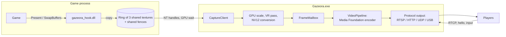

# Architecture

How Gazeora is put together: the components, the capture-to-stream pipeline, and the code
layout. For building and testing, see [Development](development.md).

## Components

| Component | Output | Responsibility |
|---|---|---|
| `libs/common` | header only | The shared-memory protocol between the hook and the host |
| `libs/hook` | `gazeora_hook.dll` | Runs inside the game. Hooks the graphics API's present call and copies frames (and depth) to shared textures. Also hooks controller reads for head tracking |
| `libs/host` | `gazeora_host_lib` | Launching and injecting, receiving frames, GPU processing, encoding, and the stream server |
| `libs/library` | `gazeora_library` | The game library (`library.json`), shared by both front ends |
| `libs/plugin_api` | header only | The C interface plugin DLLs are built against (MIT). See [Plugins](plugins.md) |
| `libs/plugin_ui` | `gazeora_plugin_ui` | Plugins' cards: their XML layouts read with pugixml, and the keys they bind to. Drawn by `Gazeora.exe` (`apps/gazeora/src/plugin_ui`) |
| `libs/plugin_kit` | `gazeora_plugin_kit` | Between the plugin interface and Gazeora's C++ codecs, outputs, game controller drivers and cards, both ways; and what the bundled plugins share (`bundled/`) |
| `libs/plugins` | `gazeora_plugins` | Loads plugin DLLs and adds their game stores, encoders, codecs, protocols, game controller drivers and cards to the registries |
| `libs/input` | `gazeora_input` | Game controllers: the controller models and the polling session. The controllers are read by a plugin's driver |
| `libs/bundled_parts` | `gazeora_bundled_parts` | The bundled plugins' protocols and codec in-process, without their DLLs, for tests, tools and benchmarks (`BundledProtocols`, `BundledVideoCodecs`) |
| `libs/update` | `gazeora_update` | [Updates](installer.md#updating): the website's release feed, the MSI download and its SHA-256 check, and starting the installer |
| `apps/gazeora` | `Gazeora.exe`, `gazeora_plugin_manager` | The launcher UI (Dear ImGui on Direct3D 11), settings, head tracking, and the stream. `src/plugin_manager` is the Plugins page's work (the plugin list on gazeora.github.io, installing and removing plugin DLLs), a library of its own for its tests |
| `apps/cli` | `GazeoraCLI.exe` | Command-line front end for the library and capture |
| `plugins/<name>` | `gazeora_<name>`, `bundled-plugins\gazeora-<name>.dll` | The [bundled plugins](plugins.md#bundled-plugins), one folder each with only that plugin's code: `udp`, `http` (with the MPEG-TS muxer), `usb` (with libusb), `h265` (its format and RTP payload) and `controller` (SDL, its switch and card). Each builds a static library of its code, which the tests, tools and benchmarks use too, and its DLL |
| `tools/` | `gazeora_testapp.exe`, `gazeora_stream_probe.exe` | [Developer tools](tools.md) |
| `installer/` | MSI | [Installer](installer.md) |

Dependencies point downward: the apps use `host`, `library`, `plugins` and `input`, and
`Gazeora.exe` also `update` and `plugin_ui`; `plugins` uses `host`, `input`, `plugin_ui`,
`plugin_api` and `plugin_kit`; the bundled plugins use `plugin_kit`, which uses `host`, `input`,
`plugin_ui` and `plugin_api`; `bundled_parts` uses the bundled plugins' libraries; `host`, `hook`
and `update` use `common`; `hook` does not depend on `host`, and nothing under `libs/` but
`bundled_parts` depends on a plugin.

## Capture to stream



1. **Launch and inject.** The launcher starts the game suspended (or attaches to a running
   one), creates a shared-memory block named after the game's process ID, and injects
   `gazeora_hook.dll` with `CreateRemoteThread` and `LoadLibraryW`. If the game exits early
   without showing a window, Gazeora treats it as a hand-off to a launcher (such as Steam
   restarting it) and waits up to 5 minutes for the real game process.
2. **Hook.** The hook detects the graphics API (Direct3D 8, 9, 10, 11, 12 or OpenGL) and hooks
   its present call with MinHook. Each frame N is copied into slot `N % 3` of a ring of shared
   textures. Direct3D 11 and 12 games use their own device; the other APIs get a private
   Direct3D 11 device inside the game.
3. **Synchronization.** The hook's GPU signals a shared frame fence when the copy is done. The
   host GPU-waits on that fence, copies the slot out, and signals a host fence. The hook reuses
   a slot only after the host is done with it, and a handshake in shared memory prevents it
   from overwriting a slot the host has just chosen to read. The game is not stalled.
4. **Depth.** With 3D from depth on, Direct3D 11 and 12 games also copy the chosen depth buffer
   into a depth slot beside each frame slot, covered by the same fence.
5. **GPU processing.** On its own Direct3D 11 device, the host scales the frame (to at most
   1920×1080), applies the VR layout and 3D views when enabled, and converts to NV12 on the GPU.
6. **Hand-off.** `FrameMailbox` passes frames from the capture thread to the encoder thread.
   Only the newest frame is kept, so delay does not build up when encoding falls behind.
7. **Encode.** `VideoPipeline` encodes with Media Foundation. With a hardware encoder that
   accepts GPU textures, frames go to it directly. Otherwise, or while the stream overlay is
   on, the frame is read back to system memory first. When the game draws fewer frames than
   the stream rate, the last frame is encoded again.
8. **Send.** The protocol output packetizes and sends the frame to every player. For UDP RTP,
   `PacketSendQueue` paces packets on a separate thread while the next frame encodes.

While no game is captured, the stream carries Gazeora's own window.

## The stream server

`FrameStreamServer` coordinates the stream. Each part has one job, and most are tested alone:

| Part | Job |
|---|---|
| `FrameMailbox` | Hands frames from the capture thread to the encoder; newest wins |
| `VideoPipeline` | NV12 conversion, encoding, parameter sets, RTP packetization. Takes the encoder from a factory, so tests use a fake |
| `VideoEncoder` | Encoder interface. Encoders come from a `VideoEncoderRegistry` ([Extension points](#extension-points)) |
| `VideoCodecFormat` | Everything the stream does that depends on the codec, apart from encoding: the RTP payload format (`RtpPayloadFormat`), the MPEG-TS stream type and access unit delimiter, the view info SEI header, which NAL units are pictures, and the GZF1 flags. `H264Format` and `H265Format`; each encoded frame carries its format, so the outputs never ask which codec they have |
| `BitrateController` | The bitrate ladder, driven by reported loss. Pure logic |
| `RtspRequest`, `RtspResponse`, `RtspReader`, `TransportSpec` | Parsing and building RTSP messages |
| `RtspConnection` | One player's socket and output queue |
| `FrameOutput` | Interface for the non-RTSP protocols: `UdpFrameOutput`, `HttpTsOutput`, `UsbAccessoryOutput`. Made by a `FrameOutputRegistry` ([Extension points](#extension-points)) |
| `TsMuxer` | Frames into an MPEG transport stream, for HTTP. Pure logic |
| `FrameHeader`, `ChunkFrame`, `StreamMessage` | The GZF1 format of the UDP and USB protocols |
| `DiscoveryResponder` | Answers the Android app's discovery requests |
| `RemoteInputReceiver` | Receives Pointer, HeadPose and CameraStatus messages over UDP, from watching players only |
| `PacingPlan`, `PacketSendQueue` | How to spread a frame's UDP packets, and the thread that sends them |
| `OverlayRenderer` | The stream overlay (only in builds with `GAZEORA_STREAM_OVERLAY=ON`) |
| `StreamLog` | The [stream log](streaming.md#stream-log) |

RTSP methods are dispatched through a table in `frame_stream.cpp`; supporting another method is
one handler and one entry. The wire formats are documented in
[Stream format](stream-format.md).

## Extension points

Protocols and codecs are known by string IDs (`StreamProtocol`, `VideoCodec`), the ones
`stream.ini` and the [discovery reply](stream-format.md#discovery) carry. What the settings page
and the discovery reply say about each comes from a catalog: `StreamProtocolCatalog` (name,
help, discovery path) and `VideoCodecCatalog` (name, settings label, bitrate share, and the
codec's `VideoCodecFormat`). A codec with no format can't be streamed: the pipeline refuses to
open it. The UDP and USB protocols mark only H.265 in the GZF1 frame header, so another codec
there also needs a flag defined in [Stream format](stream-format.md) and support in the Android
app.
`BuiltInStreamProtocols` (RTSP over TCP and over UDP) and `BuiltInVideoCodecs` (H.264) fill
them with what `Gazeora.exe` has itself, `PluginServices` adds what the plugins offer, and hands
them to the stream server and the settings page. `FrameStreamServer` defaults to those built-in
ones alone. `BundledProtocols` and `BundledVideoCodecs` (`libs/bundled_parts`) have what the
bundled plugins add, for the tests, tools and benchmarks, which run without plugins.

Three parts are chosen from a registry instead of being hard-coded. Each registry is filled at
start-up and passed in through a constructor, so tests can pass their own. The built-in
classes fill the default registries.

| Registry | Holds | Built in | Takes it |
|---|---|---|---|
| `FrameOutputRegistry` (`host/stream`) | One `FrameOutputFactory` per `StreamProtocol` | None: UDP, HTTP and USB come from the bundled plugins (`BundledProtocols` without them) | `FrameStreamServer` |
| `VideoEncoderRegistry` (`host/encode`) | `VideoEncoderProvider`s, most preferred first | Media Foundation (`BuiltInVideoEncoders`) | `FrameStreamServer`, `VideoPipeline` |
| `GameStoreRegistry` (`host/launch`) | `GameStore`s, in the order they are offered and asked | Steam (`BuiltInGameStores`) | `GameLibraryServices` |

- **Stream outputs.** Registering a factory for a protocol replaces the one already there.
  RTSP over TCP and over UDP have no factory: `FrameStreamServer` serves them itself. If no
  factory is registered for the selected protocol, `Start` fails with an error. A new protocol
  also needs an entry in the `StreamProtocolCatalog` for the settings page and the discovery
  reply.
- **Encoders.** Each time an encoder opens, it tries the providers that support the codec,
  in order, and keeps the first that opens (`FallbackVideoEncoder`). If none opens, the error
  lists each provider's reason. A codec other than H.264 is offered when any provider supports
  it. A new codec is more than a provider: it needs an entry with a `VideoCodecFormat` in the
  `VideoCodecCatalog`, and players that decode it.
- **Game stores.** A `GameStore` finds the store's id for a game from its exe, and asks the
  store's client to start the game. With **Launch through** set to *Automatic*, the game
  starts through the first store that knows its exe. The game's page lists every registered
  store. `library.json` stores the store's id in `launchVia`: `"auto"`, `"direct"`, or a
  store id such as `"steam"`. A store id that this build doesn't know is kept, and the game
  starts from its exe.

Plugin DLLs can add game stores, encoders, codecs, protocols, game controller drivers and cards
at run time ([Plugins](plugins.md)).
`PluginServices` loads the DLLs in the `plugins` folder beside the exe's `bin` folder
(`PluginFolder::Installed`) and builds the
registries: built-in stores first, then plugin stores; plugin encoders first, then Media
Foundation. Each plugin's C structs are wrapped in adapters (`PluginGameStore`,
`PluginEncoderProvider`, `PluginVideoEncoder`) that keep the DLL loaded while they exist.
Plugin codecs and protocols come after the built-in ones in their catalogs, with
`PluginCodecFormat` (and `PluginRtpPayloadFormat`) and `PluginOutputFactory` (making
`PluginFrameOutput`s) behind them. The first game controller driver is
`PluginServices::GamepadDrivers()`, a `PluginGamepadDriverFactory` making `PluginGamepadDriver`s,
which `Gazeora.exe` hands its `GamepadSession`; with none, the session never starts and reports
*Unavailable*. The driver's switch is `PluginServices::GamepadSwitch()`, which `GamepadControl`
polls every frame.

A plugin's cards (`PluginServices::UiPanels()`) are each a `UiLayout`, read from the plugin's XML
by `UiXmlParser` when it registers (`UiElementFactory` makes each element), and its values
behind `PluginUiValues`. In `Gazeora.exe`, `PluginPanelsView` draws the cards for a page where
the page asks for them, under its title and after its own content. `ImGuiUiRenderer` visits each
element and draws it with Gazeora's own widgets, binding through `UiBindings`: keys starting
with `gazeora.` go to `GazeoraUiValues`, Gazeora's own values and actions (filled in by
`GamepadUiValues` and the `App`), and the rest to the plugin. See [Plugin UI](plugin-ui.md).

The bundled plugins are Gazeora's own C++ classes behind the plugin interface:
`ExportedProtocol` and `ExportedOutput` make a `FrameOutputFactory` and its outputs a
`GazeoraProtocolV2`, `ExportedCodec` makes a `VideoCodecInfo` a `GazeoraCodecV2`, and
`ExportedGamepadDriverProvider` and `ExportedGamepadDriver` make the SDL driver a
`GazeoraGamepadDriverProviderV3`, and `ExportedUiPanel` makes a layout and its `IUiValues` a
`GazeoraUiPanelV3` (`libs/plugin_kit`). The frames `PluginFrameOutput` hands a plugin carry their codec as an
`ExportedCodec` too, which the bundled outputs read through `PluginCodecFormat`. Input that comes
over an output's own link (the USB cable) goes back through the host's `input` to
`PluginInputRouter`.

The bundled plugins aren't installed with Gazeora: they wait in `bundled-plugins`, beside
`bin` and `plugins` (`PluginFolder::Bundled`), and `BundledPluginIndex` lists them from its `bundled.json` for the
Plugins page, which installs one by copying it like a file from disk. `PluginManagerControl`
reads that list at start and loads the web's plugin list on a thread of its own
(`PluginListFetch`), so installs and uninstalls don't wait for it.

The **Plugins** page changes the plugins folder through `Gazeora.exe` run again as an
administrator (`--install-plugin` and `--uninstall-plugin`, handled by `PluginCommand` before
any window opens), as the USB driver install does. `ElevatedRun` starts that run and carries
its error back through a pipe. The elevated run checks the copy's SHA-256 in the plugins folder
itself (`PluginFolderEditor`), so a file changed after the page checked it is refused.

## x64 and x86 releases

The hook runs inside the game, so it must have the game's bitness, and so must the program that
injects it: `CreateRemoteThread` with `LoadLibraryW` only works between processes of the same
bitness. Gazeora is therefore built twice, as two complete releases. The compiler's target
picks which (`GAZEORA_ARCH`, set in `cmake/CompilerSettings.cmake`), and with it the default
install folder. The injector refuses a game of the other bitness with a message naming the
release that captures it.

Code that passes a callback to Win32 must use the callback calling convention (`CALLBACK` /
`WINAPI`, which is `__stdcall` on x86). A lambda only converts to a `__cdecl` function pointer
there, so callbacks are named functions.

## Code layout

```text
libs/                 Libraries, in dependency order
  common/               Shared-memory protocol between the hook and the host (header only)
  hook/                 gazeora_hook.dll
    core/                 API-agnostic: shared channel, hook helpers, depth picking, pixel conversion
    d3d8/ ... opengl/     One folder per graphics API: d3d8, d3d9, d3d10, d3d11, d3d12, dxgi, opengl
    input/                Controller read hooks for head tracking
  host/                 gazeora_host_lib
    launch/               Starting games (directly or through a store such as Steam) and injecting the hook
    capture/              Receiving frames, GPU scaling, the VR pass, read-back
    encode/               The VideoEncoder interface and registry, Media Foundation, NV12 conversion
    stream/               The stream server and its protocols
  library/              The game library
  plugin_api/           The C header plugins build against (MIT)
  plugin_ui/            Plugins' cards: XML layouts, their elements, and bindings
  plugin_kit/           The plugin interface and Gazeora's C++ codecs, outputs, drivers and cards;
                        bundled/: what the bundled plugins share
  plugins/              gazeora_plugins: loading plugin DLLs, adapters to the registries
  input/                Game controllers: models and the polling session
  bundled_parts/        The bundled plugins' code in-process, for tests, tools and benchmarks
  update/               Finding, downloading and starting updates (WinHTTP, CNG, msiexec)
apps/
  gazeora/              Gazeora.exe
    src/                  App, with pages/, ui/, platform/, gamepad/, keyboard/, head/,
                          plugins/, plugin_ui/, plugin_manager/, remote/, settings/, update/
                          and config/
    resources/            Icon and resource script
  cli/                  GazeoraCLI.exe
plugins/              The bundled plugins, one folder each: udp/, http/, usb/, h265/, controller/
  <name>/               include/gazeora/bundled/<name>/ and src/: only that plugin's code;
                        CMakeLists.txt: its library and DLL (cmake/BundledPlugins.cmake)
tools/                The test app, the stream probe, and license_headers.py
tests/                GoogleTest suites, mirroring the code they test
bench/                gazeora_bench, the benchmarks
installer/            The MSI: WiX sources, custom actions, Uninstall.exe
cmake/                Compiler settings, dependency fetching, formatting, signing, install rules
```

Headers live under each library's `include/gazeora/<module>/`, sources under `src/`, with the
same subfolders. For example, `libs/host/src/stream/frame_stream.cpp` implements
`libs/host/include/gazeora/host/stream/frame_stream.h`, included as
`"gazeora/host/stream/frame_stream.h"`. A bundled plugin's headers are under `plugins/<name>/include/gazeora/bundled/<name>/`, as
`"gazeora/bundled/udp/udp_frame_output.h"`. Gazeora.exe's own sources, the plugin manager's
too, are included from `apps/gazeora/src`, as `"plugin_manager/models/plugin_entry.h"`.
