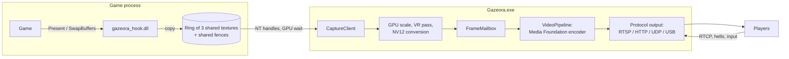

# Architecture

How Gazeora is put together: the components, the capture-to-stream pipeline, and the code
layout. For building and testing, see [Development](development.md).

## Components

| Component | Output | Responsibility |
|---|---|---|
| `libs/common` | header only | The shared-memory protocol between the hook and the host |
| `libs/hook` | `gazeora_hook.dll` | Runs inside the game. Hooks the graphics API's present call and copies frames (and depth) to shared textures. Also hooks controller reads for head tracking |
| `libs/host` | `gazeora_host_lib` | Launching and injecting, receiving frames, GPU processing, encoding, and the stream server |
| `libs/library` | `gazeora_library` | The game library (`library.json`), shared by both front ends |
| `libs/input` | `gazeora_input` | Game controllers through SDL |
| `libs/update` | `gazeora_update` | [Updates](installer.md#updating): the website's release feed, the MSI download and its SHA-256 check, and starting the installer |
| `apps/gazeora` | `Gazeora.exe` | The launcher UI (Dear ImGui on Direct3D 11), settings, head tracking, and the stream |
| `apps/cli` | `GazeoraCLI.exe` | Command-line front end for the library and capture |
| `tools/` | `gazeora_testapp.exe`, `gazeora_stream_probe.exe` | [Developer tools](tools.md) |
| `installer/` | MSI | [Installer](installer.md) |

Dependencies point downward: the apps use `host`, `library` and `input`, and `Gazeora.exe` also
`update`; `host`, `hook` and `update` use `common`; `hook` does not depend on `host`.

## Capture to stream



1. **Launch and inject.** The launcher starts the game suspended (or attaches to a running
   one), creates a shared-memory block named after the game's process ID, and injects
   `gazeora_hook.dll` with `CreateRemoteThread` and `LoadLibraryW`. If the game exits early
   without showing a window, Gazeora treats it as a hand-off to a launcher (such as Steam
   restarting it) and waits up to 5 minutes for the real game process.
2. **Hook.** The hook detects the graphics API (Direct3D 8, 9, 10, 11, 12 or OpenGL) and hooks
   its present call with MinHook. Each frame N is copied into slot `N % 3` of a ring of shared
   textures. Direct3D 11 and 12 games use their own device; the other APIs get a private
   Direct3D 11 device inside the game.
3. **Synchronization.** The hook's GPU signals a shared frame fence when the copy is done. The
   host GPU-waits on that fence, copies the slot out, and signals a host fence. The hook reuses
   a slot only after the host is done with it, and a handshake in shared memory prevents it
   from overwriting a slot the host has just chosen to read. The game is not stalled.
4. **Depth.** With 3D from depth on, Direct3D 11 and 12 games also copy the chosen depth buffer
   into a depth slot beside each frame slot, covered by the same fence.
5. **GPU processing.** On its own Direct3D 11 device, the host scales the frame (to at most
   1920×1080), applies the VR layout and 3D views when enabled, and converts to NV12 on the GPU.
6. **Hand-off.** `FrameMailbox` passes frames from the capture thread to the encoder thread.
   Only the newest frame is kept, so delay does not build up when encoding falls behind.
7. **Encode.** `VideoPipeline` encodes with Media Foundation. With a hardware encoder that
   accepts GPU textures, frames go to it directly. Otherwise, or while the stream overlay is
   on, the frame is read back to system memory first. When the game draws fewer frames than
   the stream rate, the last frame is encoded again.
8. **Send.** The protocol output packetizes and sends the frame to every player. For UDP RTP,
   `PacketSendQueue` paces packets on a separate thread while the next frame encodes.

While no game is captured, the stream carries Gazeora's own window.

## The stream server

`FrameStreamServer` coordinates the stream. Each part has one job, and most are tested alone:

| Part | Job |
|---|---|
| `FrameMailbox` | Hands frames from the capture thread to the encoder; newest wins |
| `VideoPipeline` | NV12 conversion, encoding, parameter sets, RTP packetization. Takes the encoder from a factory, so tests use a fake |
| `VideoEncoder` | Encoder interface; the Media Foundation implementation is behind it |
| `RtpPayloadFormat` | What differs between H.264 and H.265 RTP, one class per codec |
| `BitrateController` | The bitrate ladder, driven by reported loss. Pure logic |
| `RtspRequest`, `RtspResponse`, `RtspReader`, `TransportSpec` | Parsing and building RTSP messages |
| `RtspConnection` | One player's socket and output queue |
| `FrameOutput` | Interface for the non-RTSP protocols: `UdpFrameOutput`, `HttpTsOutput`, `UsbAccessoryOutput` |
| `TsMuxer` | Frames into an MPEG transport stream, for HTTP. Pure logic |
| `FrameHeader`, `ChunkFrame`, `StreamMessage` | The GZF1 format of the UDP and USB protocols |
| `DiscoveryResponder` | Answers the Android app's discovery requests |
| `RemoteInputReceiver` | Receives Pointer, HeadPose and CameraStatus messages over UDP, from watching players only |
| `PacingPlan`, `PacketSendQueue` | How to spread a frame's UDP packets, and the thread that sends them |
| `OverlayRenderer` | The stream overlay (only in builds with `GAZEORA_STREAM_OVERLAY=ON`) |
| `StreamLog` | The [stream log](streaming.md#stream-log) |

RTSP methods are dispatched through a table in `frame_stream.cpp`; supporting another method is
one handler and one entry. The wire formats are documented in
[Stream format](stream-format.md).

## x64 and x86 releases

The hook runs inside the game, so it must have the game's bitness, and so must the program that
injects it: `CreateRemoteThread` with `LoadLibraryW` only works between processes of the same
bitness. Gazeora is therefore built twice, as two complete releases. The compiler's target
picks which (`GAZEORA_ARCH`, set in `cmake/CompilerSettings.cmake`), and with it the default
install folder. The injector refuses a game of the other bitness with a message naming the
release that captures it.

Code that passes a callback to Win32 must use the callback calling convention (`CALLBACK` /
`WINAPI`, which is `__stdcall` on x86). A lambda only converts to a `__cdecl` function pointer
there, so callbacks are named functions.

## Code layout

```text
libs/                 Libraries, in dependency order
  common/               Shared-memory protocol between the hook and the host (header only)
  hook/                 gazeora_hook.dll
    core/                 API-agnostic: shared channel, hook helpers, depth picking, pixel conversion
    d3d8/ ... opengl/     One folder per graphics API: d3d8, d3d9, d3d10, d3d11, d3d12, dxgi, opengl
    input/                Controller read hooks for head tracking
  host/                 gazeora_host_lib
    launch/               Starting games (directly or through Steam) and injecting the hook
    capture/              Receiving frames, GPU scaling, the VR pass, read-back
    encode/               The VideoEncoder interface, Media Foundation, NV12 conversion
    stream/               The stream server and its protocols
  library/              The game library
  input/                Game controllers (SDL)
  update/               Finding, downloading and starting updates (WinHTTP, CNG, msiexec)
apps/
  gazeora/              Gazeora.exe
    src/                  App, with pages/, ui/, platform/, gamepad/, keyboard/, head/,
                          remote/, settings/, update/ and config/
    resources/            Icon and resource script
  cli/                  GazeoraCLI.exe
tools/                The test app, the stream probe, and license_headers.py
tests/                GoogleTest suites, mirroring the code they test
bench/                gazeora_bench, the benchmarks
installer/            The MSI: WiX sources, custom actions, Uninstall.exe
cmake/                Compiler settings, dependency fetching, formatting, signing, install rules
```

Headers live under each library's `include/gazeora/<module>/`, sources under `src/`, with the
same subfolders. For example, `libs/host/src/stream/frame_stream.cpp` implements
`libs/host/include/gazeora/host/stream/frame_stream.h`, included as
`"gazeora/host/stream/frame_stream.h"`.
