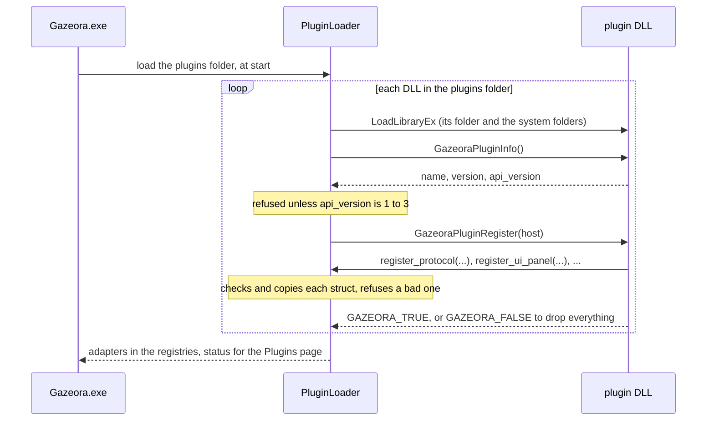

# Plugin development

How to write, build, test and publish a Gazeora plugin. For installing and managing plugins,
see [Plugins](plugins.md). For the XML of the cards a plugin adds to Gazeora's pages, see
[Plugin UI](plugin-ui.md).

The plugin interface itself is one C header,
[`gazeora_plugin.h`](../libs/plugin_api/include/gazeora/plugin_api/gazeora_plugin.h). Its
comments are the reference for every struct and function. This guide explains how to use it.

## Two kinds of plugin

| | Third-party plugin | Bundled plugin |
|---|---|---|
| What it is | Any plugin written outside this repository | One of Gazeora's own plugins, which come with Gazeora ([Bundled plugins](plugins.md#bundled-plugins)) |
| Built against | `gazeora_plugin.h` only | `gazeora_plugin.h` and Gazeora's own libraries, through `libs/plugin_kit` |
| Language and compiler | Any that can export C functions | C++17, in Gazeora's CMake build |
| License | Any, closed-source included (see [License](#license)) | Gazeora's |
| Where its code lives | Anywhere | `plugins/<name>/` in this repository |
| How it reaches players | Install from file, or the [plugin list](#publishing-to-the-plugin-list) | `bundled-plugins\` in every Gazeora install |
| Start from | [The example plugin](#the-example-plugin) | [Bundled plugins](#bundled-plugins) |

Both kinds are the same to Gazeora: a DLL in the `plugins` folder that exports two functions.

## What a plugin can add

| Part | Plugin API version | Registered with | Reference |
|---|---|---|---|
| Game store | 1 | `register_game_store` | [Game stores](#game-stores) |
| Video encoder | 1 (codec ids: 2) | `register_encoder_provider` | [Encoders](#encoders) |
| Codec | 2 | `register_codec` | [Codecs](#codecs) |
| Protocol | 2 | `register_protocol` | [Protocols](#protocols) |
| Game controller driver | 3 | `register_gamepad_driver_provider` | [Game controller drivers](#game-controller-drivers) |
| Card on a page | 3 | `register_ui_panel` | [Plugin UI](plugin-ui.md) |
| Its own settings | 3 | `settings_folder` | [Settings](#settings) |

Capture can't be extended by plugins, and the UI only through cards. The controller navigation
is Gazeora's own: a driver only reports the buttons and sticks.

## How Gazeora loads a plugin



1. When `Gazeora.exe` (or `GazeoraCLI plugins`) starts, `PluginServices` lists the DLLs in the
   `plugins` folder beside the `bin` folder the exe is in.
2. Each DLL is loaded with `LoadLibraryExW`, so a DLL it needs is looked for in its own folder
   and the system folders, not the current directory. A DLL for the other architecture is
   refused before it loads.
3. `GazeoraPluginInfo` must return a `GazeoraPluginInfoV1` whose `api_version` is between
   `GAZEORA_PLUGIN_API_OLDEST_VERSION` (1) and Gazeora's `GAZEORA_PLUGIN_API_VERSION` (3).
4. `GazeoraPluginRegister` gets Gazeora's newest host, whatever version the plugin reported.
   Each `register_*` checks the struct, copies it and returns `GAZEORA_TRUE`, or refuses it,
   returns `GAZEORA_FALSE` and notes why for the **Plugins** page. The plugin's other parts
   still load.
5. If `GazeoraPluginRegister` returns `GAZEORA_FALSE`, Gazeora drops everything the plugin
   registered.
6. Gazeora wraps each registered struct in an adapter (for example `PluginOutputFactory`) that
   keeps the DLL loaded while the adapter exists, and adds it to the registries. See
   [Architecture](architecture.md#plugins).

Plugins load only when Gazeora starts. A plugin installed, updated or removed while Gazeora runs
takes effect at the next start. [Why a plugin doesn't load](plugins.md#why-a-plugin-doesnt-load)
lists the errors the **Plugins** page shows.

## The example plugin

[`examples/plugins/frame_recorder`](../examples/plugins/frame_recorder) is a complete
third-party plugin to start from. It uses nothing of Gazeora's but `gazeora_plugin.h`. It adds:

- a protocol, **Record to file**, that writes the game's frames to an `.h264` or `.h265` file
  instead of streaming them;
- a card on the **Settings** page to turn recording on and off, choose the folder, see how the
  recording stands and start a new file;
- its own settings file, `frame-recorder.ini`, in Gazeora's settings folder.

Gazeora's own build compiles it too, and `gazeora_plugin_tests` loads it as Gazeora does and
records frames through it (`tests/examples/frame_recorder_test.cpp`).

### Build it

The example builds on its own, with CMake and MSVC, from a **Developer PowerShell for VS** (see
[Development](development.md#configure-and-build)) in the repository root:

```powershell
cmake -S examples/plugins/frame_recorder -B build-recorder -G Ninja -DCMAKE_BUILD_TYPE=Release
cmake --build build-recorder
```

This makes `build-recorder\frame-recorder.dll`. Use the x64 tools for the x64 release of
Gazeora and the x86 tools for the x86 release. A plugin's architecture must match Gazeora's.

To build it outside this repository, copy the folder and point CMake at the header:

```powershell
cmake -S frame_recorder -B build -G Ninja -DCMAKE_BUILD_TYPE=Release -DGAZEORA_PLUGIN_API_INCLUDE_DIR=C:\path\to\libs\plugin_api\include
```

The DLL links the C runtime statically, so it needs no Visual C++ Redistributable, and it
depends only on `KERNEL32.dll`, `SHELL32.dll` and `ole32.dll`. Check what a DLL exports and
depends on with `dumpbin`:

```powershell
dumpbin /exports build-recorder\frame-recorder.dll     # GazeoraPluginInfo, GazeoraPluginRegister
dumpbin /dependents build-recorder\frame-recorder.dll
```

### Try it

1. On the **Plugins** page, choose **Install from file** and pick `frame-recorder.dll`. It
   installs as `frame-recorder`. Approve the administrator prompt.
2. Restart Gazeora. **Installed** lists **Frame recorder** with what it added: a protocol and a
   card.
3. In **Settings → Frame stream**, choose **Record to file** as the protocol. The **Frame
   recorder** card is on the same page.
4. Play a game. The card says where it's recording. Files go to `Videos\Gazeora` until another
   folder is chosen on the card, named after the time they start, such as
   `Gazeora 2026-11-01 14-03-22.h264`.

The recording stops when the protocol changes, when **Record** is turned off, and when Gazeora
closes. **Start a new file** ends it and starts another at the next key frame. Only a game's
frames are recorded, not Gazeora's own window: Gazeora sends that only to an output with
viewers, and a file has none.

The files are raw H.264 or H.265 streams (Annex B). VLC 3.0.24 opened and decoded the example's
H.264 and H.265 files in testing.

### How it's built

| File | Class | Job |
|---|---|---|
| `src/frame_recorder_plugin.cpp` | None | The two exports, and the one `FrameRecorder` the DLL keeps |
| `src/frame_recorder.h` | `FrameRecorder` | Facade: makes the parts and registers them |
| `src/recorder_protocol.h` | `RecorderProtocol` | Factory Method: the `GazeoraProtocolV2`, making a `RecorderOutput` each time the protocol is chosen |
| `src/recorder_output.h` | `RecorderOutput` | Adapter: one `GazeoraOutputV2` onto the `Recording` |
| `src/recorder_panel.h` | `RecorderPanel` | Adapter: the `GazeoraUiPanelV3`, its keys and actions onto the settings and the recording |
| `src/recording.h` | `Recording` | The recording, shared by the encode thread and the UI thread, behind a mutex |
| `src/file_start.h` | `FileStart` | Where a file's first frame starts: after its access unit delimiters, found through the frame's codec |
| `src/annexb_file.h`, `src/recording_name.h` | `AnnexBFile`, `RecordingName` | The file on disk, and its name |
| `src/recorder_settings.h`, `src/settings_file.h` | `RecorderSettings`, `SettingsFile` | The card's choices, saved in `frame-recorder.ini` (Repository) |
| `src/guarded.h`, `src/text_buffer.h`, `src/utf8_path.h`, `src/videos_folder.h` | | No exception leaves a plugin function; text into Gazeora's buffers; UTF-8 paths; the default folder |
| `ui/recorder_panel.xml` | | The card's layout, built into the DLL as a string |

The pattern every part follows: a C++ object fills a C struct with `self = this` and static
functions, and each static function turns `self` back into the object:

```cpp
GazeoraOutputV2 RecorderOutput::Struct() {
    GazeoraOutputV2 output = {};
    output.struct_size = sizeof(GazeoraOutputV2);
    output.self = this;
    output.start = Start;
    output.send = Send;
    // ...
    output.destroy = Destroy;
    return output;
}

void GAZEORA_CALL RecorderOutput::Send(void* self, const GazeoraFrameV2* frame,
                                       const GazeoraLossReporterV2*) {
    Guarded::Run([&] { Of(self).m_recording.Write(*frame); /* ... */ });
}

void GAZEORA_CALL RecorderOutput::Destroy(void* self) { delete &Of(self); }
```

An object whose struct Gazeora keeps (the protocol and the card) must not move, so those
classes can't be copied, and the DLL keeps them in one `FrameRecorder` until it unloads. An
object Gazeora asks for (an output) is created with `new` and freed in its `destroy`.

## Writing a plugin

### Project setup

- **The header.** Include `gazeora/plugin_api/gazeora_plugin.h` and nothing else of Gazeora's.
  Copy it into your project or point your include path at `libs/plugin_api/include`.
- **Compiler.** The header is plain C. The example is C++17 and is built with MSVC. Gazeora
  itself also builds with MinGW-w64 ([Development](development.md#prerequisites)), but a
  MinGW-built plugin hasn't been tested.
- **Architecture.** Build an x64 DLL for the x64 release and an x86 DLL for the x86 release.
  Publish both if you can.
- **Exports.** Export `GazeoraPluginInfo` and `GazeoraPluginRegister` with C linkage and the
  `__cdecl` convention: declare them with `GAZEORA_PLUGIN_EXPORT` and `GAZEORA_CALL` and their
  names stay undecorated, also on x86.
- **Runtime.** Link the C runtime statically (`/MT`, or `CMAKE_MSVC_RUNTIME_LIBRARY` set to
  `MultiThreaded`), or install the runtime your plugin needs. Gazeora doesn't install one for
  plugins.
- **Dependencies.** Put any DLL your plugin needs beside it in the `plugins` folder, or link it
  statically. Every DLL in that folder is tried as a plugin, so a helper DLL there shows on the
  **Plugins** page as `not a Gazeora plugin`. Linking statically avoids that.
- **Name.** Gazeora installs a plugin as `<id>.dll`. A file installed from disk is named after
  the file, in lowercase, with characters other than letters, digits, `-` and `_` turned into
  `-`.

### The two exports

A minimal plugin with one game store:

```c
#include <stdio.h>
#include <string.h>

#include "gazeora/plugin_api/gazeora_plugin.h"

static void GAZEORA_CALL AppIdFor(void* self, const char* exe_path, char* app_id,
                                  size_t capacity) {
    /* Look the exe up in the store's install records; "" if it isn't the store's. */
    snprintf(app_id, capacity, "%s", strstr(exe_path, "\\ExampleStore\\") ? "42" : "");
}

static int32_t GAZEORA_CALL Launch(void* self, const char* app_id, char* error,
                                   size_t capacity) {
    /* Ask the store's client to start the game, for example through its URL scheme. */
    snprintf(error, capacity, "not implemented");
    return GAZEORA_FALSE;
}

static const GazeoraPluginInfoV1 kInfo = {sizeof(GazeoraPluginInfoV1),
                                          GAZEORA_PLUGIN_API_VERSION, "Example store", "1.0.0"};
static const GazeoraGameStoreV1 kStore = {sizeof(GazeoraGameStoreV1), NULL, "example",
                                          "Example store", AppIdFor, Launch};

GAZEORA_PLUGIN_EXPORT const GazeoraPluginInfoV1* GAZEORA_CALL GazeoraPluginInfo(void) {
    return &kInfo;
}

GAZEORA_PLUGIN_EXPORT int32_t GAZEORA_CALL GazeoraPluginRegister(const GazeoraPluginHostV1* host) {
    return host->register_game_store(host->context, &kStore);
}
```

| Export | Does |
|---|---|
| `GazeoraPluginInfo` | Returns a `GazeoraPluginInfoV1`: the plugin's name and version for the **Plugins** page, and the plugin API version it needs |
| `GazeoraPluginRegister` | Registers what the plugin offers through the host it's given. For codecs and protocols, `GazeoraPluginHostV2Of(host)` gives the version 2 host, or `NULL` from a Gazeora that has only version 1; for game controller drivers, cards and the settings folder, `GazeoraPluginHostV3Of(host)` gives the version 3 host. Returning `GAZEORA_FALSE` drops everything it registered |

`version` is `MAJOR.MINOR.PATCH`, the same as the plugin list's, so **Update** can compare
them.

[`tests/plugins/sample_plugin`](../tests/plugins/sample_plugin) is another complete plugin, with
a game store, an encoder, a codec, a protocol, a game controller driver and a card, which the
tests load. It's built three times: for version 3, for version 1, and for a version Gazeora
doesn't have.

### Rules

- Strings are UTF-8 and NUL-terminated. Text a plugin returns goes into the buffer Gazeora
  passes, truncated to its capacity (which counts the NUL).
- No exception or `longjmp` may leave a plugin function. A plugin that crashes takes Gazeora
  down with it. Catch everything at the boundary, as the example's `Guarded` does.
- Pointers Gazeora passes are valid only during the call, unless the header says otherwise.
- Gazeora copies the structs a plugin registers, but the strings and functions they point to
  must stay valid while the DLL is loaded.
- Each struct starts with `struct_size`; set it to `sizeof` the struct. Zero the struct first
  (`= {}` in C++, `memset` in C), so the optional functions you don't set are `NULL`.
- Keep ids the same across versions: `library.json` and `stream.ini` store them.

### Who owns what

| What | Valid | Who frees it |
|---|---|---|
| The `GazeoraPluginHostV*` and its `settings_folder` | During `GazeoraPluginRegister`. Copy the folder | Gazeora |
| A struct the plugin registers | Gazeora keeps a copy; what it points to must live while the DLL is loaded | The plugin, when the DLL unloads |
| An encoder, output or controller driver the plugin creates when asked (`create`, `create_output`) | Until Gazeora calls its `destroy` | The plugin, in `destroy` |
| `GazeoraOutputHostV2` | While the output exists | Gazeora |
| A frame, loss reporter, sink or text Gazeora passes | During the call | Gazeora |
| An `ID3D11Device` or texture Gazeora passes | During the call. `AddRef` it to keep it | Whoever holds a reference |

If `create` or `create_output` returns `GAZEORA_FALSE`, Gazeora doesn't call `destroy`: free
anything made so far before returning.

### Threads

| Functions | Called |
|---|---|
| `GazeoraPluginInfo`, `GazeoraPluginRegister` | Once each, while Gazeora starts |
| Game store `app_id_for`, `launch` | From any thread, also at the same time |
| Encoder provider `supports`, `supports_id`, `create` | From any thread |
| An encoder's functions | From one thread, which has COM (multithreaded) and `MFStartup` |
| Codec functions | From any thread |
| An output's `start`, `stop`, `send` | One at a time; `send` on Gazeora's encode thread |
| An output's other functions | From any thread, at any time |
| `GazeoraOutputHostV2` `log` and `input` | The plugin may call them from any thread |
| Controller provider `create` | On the thread that then polls the driver |
| Controller provider `enabled` | On the UI thread, every frame |
| A controller driver's functions | On the thread that created it, about 125 times a second |
| A card's `get`, `set`, `action` | On the UI thread, while the card is shown; `get` every frame for each value shown |

Anything shared between those threads needs a lock or an atomic. In the example, the card (UI
thread) and the output (encode thread) share the `Recording`, which has a mutex.

### Versions

This is plugin API version 3 (`GAZEORA_PLUGIN_API_VERSION`). Gazeora loads plugins that report
versions 1 to 3 (`GAZEORA_PLUGIN_API_OLDEST_VERSION` to `GAZEORA_PLUGIN_API_VERSION`), and says
so on the **Plugins** page for any other. A struct a version extends is a new struct whose first
member is the older one, so a plugin for an older version works unchanged. Gazeora reads a
plugin's newer fields only when its `struct_size` covers them.

- **Report the oldest version you need** in `GazeoraPluginInfoV1::api_version`. A Gazeora
  refuses a plugin that reports a newer version than its own, but hands every plugin its newest
  host. The example reports 2, because protocols came with version 2, and registers its card
  only when `GazeoraPluginHostV3Of(host)` isn't `NULL`.
- **Check before using a newer host.** `GazeoraPluginHostV2Of` and `GazeoraPluginHostV3Of`
  return `NULL` from a Gazeora that doesn't have that version.

| Version | Added |
|---|---|
| 1 | Game stores and encoders |
| 2 | Codecs, protocols, encoders that take codec ids (`GazeoraEncoderProviderV2`) |
| 3 | Game controller drivers, cards, and the settings folder |

### Settings

The version 3 host's `settings_folder` is the folder Gazeora keeps its own settings in
(`%APPDATA%\Gazeora`), as UTF-8. Keep settings in a file named after the plugin there, as the
example does with `frame-recorder.ini`, and copy the path during `GazeoraPluginRegister`. It's
`""` when Gazeora has no settings folder, as in the tests: then keep nothing.

## Reference

### Game stores

- `id` is stored in `library.json` as the game's `launchVia`, so keep it the same across
  versions. It's lowercase `a`–`z`, `0`–`9` and `-`, at most 64 characters, and not `auto` or
  `direct`. A store with an invalid id is refused.
- Plugin stores come after Gazeora's own ones. A plugin store with the id of a built-in store,
  such as `steam`, replaces it.
- `app_id_for` and `launch` can be called from any thread, also at the same time.
- After `launch`, Gazeora waits for the game's process by its exe name, as it does for Steam.

### Encoders

- Each time the stream opens an encoder, Gazeora tries the encoder plugins in load order, then
  Media Foundation, and keeps the first that opens for the codec.
- An encoder is used from one thread, which has COM (multithreaded) and `MFStartup`.
- Frames are NV12. With `d3d11_device` set in the settings, they come as `ID3D11Texture2D`
  textures on that device through `encode_texture`, and an encoder without `encode_texture`
  refuses to open with a device. Gazeora then reads frames back to memory instead.
- `AddRef` the device or a texture to keep it past the call.
- Output is Annex B (NAL units with start codes), without B-frames.

### Codecs

A codec plugin describes a codec whose bitstream is NAL units in Annex B, as H.264, H.265 and
H.266 are, in a `GazeoraCodecV2`. Encoding it is an encoder's job: register an encoder provider
as a `GazeoraEncoderProviderV2`, whose `supports_id` takes codec ids, and read the codec's id from
the `GazeoraEncoderSettingsV2` that `open` gets.

- `id` follows the same rules as a game store's, and stream.ini and the discovery reply carry it.
  A plugin codec with a built-in codec's id replaces it.
- Gazeora builds the RTP packets itself: a NAL unit that fits goes in a packet of its own, and a
  larger one is cut into fragmentation units, each with the payload header
  `fragment_payload_header` gives, then a byte with the start and end bits and the NAL type.
- `fmtp` gives the SDP `fmtp` line from the parameter sets seen so far, and
  `required_parameter_sets` the ones a key frame needs in front of it. Gazeora puts them there.
- `ts_stream_type` and `access_unit_delimiter` are for the HTTP protocol's MPEG transport
  stream.
- `sei_header` is the header of an SEI NAL unit, which carries the VR viewer settings to the
  Gazeora app. With a size of 0, frames of this codec go without them.
- The UDP and USB protocols mark only H.265 in their frame header, so the Gazeora app treats any
  other codec on them as H.264. Players also need a decoder for the codec.

### Protocols

A protocol plugin registers a `GazeoraProtocolV2`, whose `create_output` makes the
`GazeoraOutputV2` that runs while the protocol is chosen.

- `id` follows the same rules as a game store's, but can't be `rtsp-tcp` or `rtsp-udp`, which
  the stream server serves itself. A plugin protocol with another built-in id (`udp`, `http`,
  `usb`) replaces it.
- `name`, `help`, `discovery_path` and `create_output` are required.
- `start`, `stop` and `send` are called one at a time. The other functions can be called from
  any thread at any time.
- `send` gets each encoded frame, and a `GazeoraLossReporterV2` to report the share of packets
  a player lost, so the stream lowers its bitrate. Both are valid during the call only. The
  frame's `codec` describes its codec as a codec plugin does, also for H.264, and stays valid
  while the output exists.
- Frames are Annex B, with the parameter sets in front of each key frame. A frame may start
  with an access unit delimiter: Media Foundation's H.264 and H.265 encoders put one there.
- While `viewers` is 0, Gazeora still sends the output a game's frames, but not its own window's.
- `take_key_frame_request` returning `GAZEORA_TRUE` makes the next frame a key frame: return
  it once when a player joins or loses a frame.
- The `GazeoraOutputHostV2` it's made with stays valid while the output exists. Its `log`
  writes a line to the [stream log](streaming.md#stream-log).
- Touches, head poses and camera status the Gazeora app sends over the network go to Gazeora
  itself, which takes them only from a player that `watching` says is watching. Without
  `watching`, it takes none.
- An output whose players send them over its own link, such as a cable, hands each message to
  the host's `input`: the type (`GAZEORA_INPUT_*`) and the payload of that
  [GZF1 message](stream-format.md).
- `app_viewers` counts the viewers that are the Gazeora app; without it, every viewer counts.
- `needs_usb_driver` and `usb_devices_needing_driver` let the settings offer the USB driver
  Gazeora installs, as the USB protocol does.
- `status`, `app_viewers`, `watching`, `needs_usb_driver` and `usb_devices_needing_driver` may
  be `NULL`.

### Game controller drivers

A game controller driver registers a `GazeoraGamepadDriverProviderV3` through
`register_gamepad_driver_provider` of the version 3 host. Its `create` makes the
`GazeoraGamepadDriverV3` that reads the controllers.

- Gazeora uses the first driver registered, in plugin load order, and ignores the others. With
  none, it reads no controllers.
- `enabled`, if the provider has it, is the plugin's own switch: Gazeora reads controllers only
  while it returns `GAZEORA_TRUE`. It's asked on the UI thread, every frame. Without it,
  controllers are always read. A plugin with a switch shows it on a [card](plugin-ui.md) and
  keeps it in its [settings](#settings), as the Game Controller plugin does.
- `create` is called on the thread that then uses the driver, and only that thread calls the
  driver's functions: `update` about 125 times a second, each followed by `connected` and
  `state`. The driver is created when Gazeora starts reading controllers and destroyed when it
  stops: when `enabled` turns false, and while a game launched from Gazeora runs, so the game
  has the controllers to itself. `destroy` must let go of them.
- `create` returning `GAZEORA_FALSE` makes its `error` text `gazeora.gamepad.status`, which a
  card can show with **Try again** ([Gazeora's values](plugin-ui.md#gazeoras-values)).
- `connected` hands each connected controller's name to the sink, for the card.
- `state` merges every connected controller: a button is held if any controller holds it, and
  each stick takes the value furthest from the center. Buttons are bits
  `1u << GAZEORA_GAMEPAD_BUTTON_*`, named by where they sit, as on the
  [Game controller](game-controller.md) page. Sticks are `axes[GAZEORA_GAMEPAD_AXIS_*]`, from -1
  to 1, X positive to the right and Y positive down. Gazeora applies its own dead zone, ignores
  unknown button bits, and clamps stick values to -1 to 1.

### Cards

A card is a `GazeoraUiPanelV3`: its layout as XML, and `get`, `set` and `action` for the values
and buttons on it. See [Plugin UI](plugin-ui.md) for the layout and the values.

The example keeps its layout in `ui/recorder_panel.xml` and turns it into a string in the DLL
when it builds, so the layout can be edited as XML:

```cmake
file(READ ${CMAKE_CURRENT_SOURCE_DIR}/ui/recorder_panel.xml layout_text)
file(CONFIGURE OUTPUT ${CMAKE_CURRENT_BINARY_DIR}/generated/recorder_panel_xml.h
    CONTENT "#pragma once\n\nconstexpr char kRecorderPanelXml[] = R\"xml(${layout_text})xml\";\n"
    @ONLY)
```

Gazeora checks the layout when the card registers, and refuses a card whose layout is wrong.
A test that loads the plugin, as the example's does, catches a wrong layout before a player
does.

## Testing and debugging

- **Load it without installing.** A Gazeora built from source loads plugins from `plugins\`
  beside its `bin\` folder: with the Ninja build in [Development](development.md), that's
  `build\plugins\`, which needs no administrator rights. Copy the DLL there and start
  `build\bin\Gazeora.exe`.
- **See whether it loaded.** The **Plugins** page shows each DLL, whether it loaded, what it
  added and why not. `GazeoraCLI plugins` prints the same in a console. See
  [Why a plugin doesn't load](plugins.md#why-a-plugin-doesnt-load).
- **Log.** A protocol's output can write to the [stream log](streaming.md#stream-log)
  (`%APPDATA%\Gazeora\stream.log`) through its host's `log`, as the example does when it opens
  a file.
- **Debug.** A plugin runs inside `Gazeora.exe`. Attach a debugger to it, or start it from
  the debugger, with the plugin's PDB beside its DLL.
- **Test it as Gazeora loads it.** In this repository, a test can load a plugin DLL with
  `PluginServices` and use what it registered through Gazeora's own interfaces, as
  `tests/examples/frame_recorder_test.cpp` does for the example and
  `tests/plugins/plugin_dll_test.cpp` for the sample plugin.

## Publishing to the plugin list

The plugin list is `data/plugins/windows/index.json` in the
[gazeora.github.io](https://github.com/Gazeora/gazeora.github.io) repository. It's edited by
hand. Each entry:

```json
{
 "platform": "windows",
 "api_version": 1,
 "plugins": [
  {
   "id": "example-store",
   "name": "Example store",
   "summary": "Starts games through the Example store's client",
   "author": "Example Author",
   "license": "MIT",
   "homepage": "https://example.com/gazeora-plugin",
   "version": "1.0.0",
   "api_version": 1,
   "assets": {
    "x64": {
     "name": "example-store-x64.dll",
     "size": 45056,
     "browser_download_url": "https://example.com/example-store-x64.dll",
     "digest": "sha256:<64 hex digits>"
    },
    "x86": {"name": "...", "size": 0, "browser_download_url": "...", "digest": "sha256:..."}
   }
  }
 ]
}
```

| Field | Rules |
|---|---|
| `id` | Required. `a`–`z`, `0`–`9`, `-` and `_`, at most 64 characters. The plugin installs as `<id>.dll`, whatever its download is called |
| `name`, `version` | Required. `version` is `MAJOR.MINOR.PATCH`, the same as `GazeoraPluginInfo` reports, so **Update** can compare them |
| `summary`, `author`, `license` | Shown on the page and searched |
| `category` | What kind of plugin it is, for the page's label and filter: `protocol`, `codec`, `encoder`, `game-store`, `controller` or `other`. Without it, or with another word, an installed plugin's category comes from what it registered most of, and one that isn't installed shows as *Other* |
| `homepage` | Shown as **Website**. Only `https://` addresses are kept |
| `api_version` | The plugin API version the build is for. Builds for a version this Gazeora doesn't load are listed but can't be installed |
| `assets` | One build per architecture, `x64` and `x86`. A download must be `https://` and have a `sha256:` digest, or it's left out. A `size` of 0 skips the size check |

Entries that break these rules are left out of the page. Get the digest of a build with:

```powershell
(Get-FileHash .\example-store-x64.dll -Algorithm SHA256).Hash.ToLower()
```

## License

The header is under the MIT license
([libs/plugin_api/LICENSE](../libs/plugin_api/LICENSE)), and a plugin that uses only the header
can have any license, closed-source included. See the additional permission for plugins in
[NOTICE](../NOTICE).

The example plugin and the sample plugin are under Gazeora's own license
(`GPL-3.0-only OR LicenseRef-Gazeora-Commercial`), like the rest of this repository. A plugin
that copies their code takes that license with it. A plugin that uses only the header doesn't.

## Bundled plugins

Gazeora's own plugins live in this repository, one folder each under `plugins/`, with only that
plugin's code. They're C++ and use Gazeora's own classes through `libs/plugin_kit`, which puts
them behind the plugin interface. They come with Gazeora in `bundled-plugins\`, and the
**Plugins** page installs them from there.

### A bundled plugin's folder

```text
plugins/<name>/
  CMakeLists.txt                     Its library and its DLL
  include/gazeora/bundled/<name>/    Headers of its library, included as "gazeora/bundled/<name>/..."
  src/                               Its library's sources, and the DLL's entry point
  ui/                                Card layouts, if it has cards
```

Its `CMakeLists.txt` makes two targets:

- `gazeora_<name>`, a static library of the plugin's own code, which the tests, tools and
  benchmarks link to use it without the DLL;
- the DLL, through `gazeora_add_bundled_plugin`
  ([`cmake/BundledPlugins.cmake`](../cmake/BundledPlugins.cmake)).

```cmake
add_library(gazeora_udp STATIC src/udp_frame_output.cpp)
target_include_directories(gazeora_udp PUBLIC ${CMAKE_CURRENT_SOURCE_DIR}/include)
target_link_libraries(gazeora_udp PUBLIC gazeora_host_lib PRIVATE bcrypt)

gazeora_add_bundled_plugin(gazeora_udp_plugin
    ID gazeora-udp CATEGORY protocol NAME "UDP Direct"
    SUMMARY "Streams to the Gazeora app over UDP: the least delay and overhead on Wi-Fi."
    SOURCES src/udp_plugin.cpp
    LIBS gazeora_udp)
```

`gazeora_add_bundled_plugin` builds `<ID>.dll` into `bundled-plugins\`, adds the
`GazeoraPluginInfo` export (reporting `NAME` and Gazeora's version), signs the DLL when the
build signs, and adds the plugin's entry to `bundled.json`, which the **Plugins** page lists
under **Available**. `cmake --install` and the MSI take every bundled plugin from there.

`gazeora_embed_text(<target> <file> <header> <name>)` turns a file, such as a card's XML, into a
`constexpr char <name>[]` in a generated header.

### The entry point

A bundled plugin writes only `GazeoraPluginRegister`, with the helpers in
[`bundled_plugin.h`](../libs/plugin_kit/include/gazeora/plugin_kit/bundled/bundled_plugin.h)
and the exporters in `libs/plugin_kit/include/gazeora/plugin_kit/exports/`:

| Gazeora's C++ | Exporter | Becomes |
|---|---|---|
| A `FrameOutput` with a static `Info()` | `BundledPlugin::RegisterProtocolOf<Output>` | A protocol (UDP, HTTP, USB) |
| A `FrameOutputFactory` and its `StreamProtocolInfo` | `ExportedProtocol` | A `GazeoraProtocolV2` |
| A `VideoCodecInfo` with a `VideoCodecFormat` | `ExportedCodec` | A `GazeoraCodecV2` (H.265) |
| An `IGamepadDriverFactory` and an `IGamepadSwitch` | `ExportedGamepadDriverProvider` | A `GazeoraGamepadDriverProviderV3` (Game Controller) |
| A layout's XML and its `IUiValues` | `ExportedUiPanel` | A `GazeoraUiPanelV3` |

```cpp
// plugins/udp/src/udp_plugin.cpp
GAZEORA_PLUGIN_EXPORT int32_t GAZEORA_CALL GazeoraPluginRegister(const GazeoraPluginHostV1* host) {
    return gazeora::BundledPlugin::RegisterProtocolOf<gazeora::UdpFrameOutput>(host);
}

// plugins/h265/src/h265_plugin.cpp
GAZEORA_PLUGIN_EXPORT int32_t GAZEORA_CALL GazeoraPluginRegister(const GazeoraPluginHostV1* host) {
    static const gazeora::ExportedCodec codec(gazeora::H265Format::Info());
    return gazeora::BundledPlugin::RegisterCodec(host, codec.Codec());
}
```

`ExportedProtocol` (making an output), `ExportedGamepadDriverProvider`, `ExportedGamepadDriver`
and `ExportedUiPanel` catch exceptions at the boundary. `ExportedOutput` and `ExportedCodec`
don't, so the outputs and codec formats behind them must not throw.
[`plugins/controller`](../plugins/controller) is the fullest example: a driver, its switch, a
card and its own settings file.

### Adding a bundled plugin

1. Make `plugins/<name>/` with its `CMakeLists.txt`, as above.
2. Add `add_subdirectory(<name>)` to [`plugins/CMakeLists.txt`](../plugins/CMakeLists.txt).
3. If tests, tools or benchmarks need its protocol or codec without the DLL, add it to
   `BundledProtocols` or `BundledVideoCodecs` in `libs/bundled_parts`.
4. Add tests under `tests/plugins/<name>/`, and update `BundledPluginsTest` in
   `tests/plugins/bundled_plugins_test.cpp`, which checks that every bundled plugin loads.
5. List it in the [Bundled plugins](plugins.md#bundled-plugins) table, and add any new
   third-party library to `THIRD_PARTY_NOTICES.md` and [Development](development.md#prerequisites).

Nothing under `libs/` or `apps/` may depend on a bundled plugin's code, apart from
`libs/bundled_parts` ([Architecture](architecture.md#components)).
